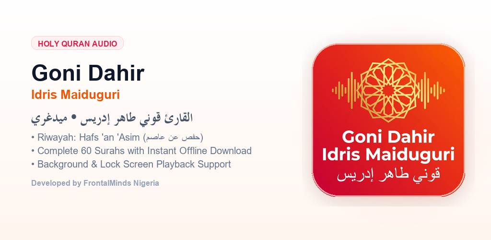
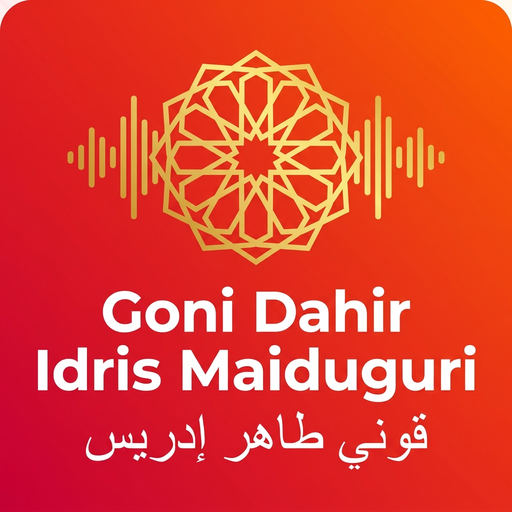

# 📖 Goni Dahir Quran Audio (القارئ قوني طاهر إدريس مَيْدُغُرِي)

<p align="center">
  
</p>

<p align="center">
  <a href="https://flutter.dev"></a>
  <a href="https://dart.dev"></a>
  <a href="https://developer.android.com"></a>
  <a href="https://github.com/yaseeradam/goni-dahir-quran"></a>
  <a href="LICENSE"></a>
  <a href="https://quran.academyhub.com.ng/Goni_Dahir_Quran.apk"></a>
</p>

<p align="center">
  <strong>بِسْمِ اللَّهِ الرَّحْمَٰنِ الرَّحِيمِ</strong><br>
  <em>A modern, elegant, and high-performance Flutter Quran audio application delivering the serene recitations of <strong>Goni Dahir Idris Maiduguri</strong> in canonical <strong>Hafs 'an 'Asim (حفص عن عاصم)</strong>.</em>
</p>

---

## 🌟 Highlights & Key Features

<table>
  <tr>
    <td width="50%">
      <h3>🎙️ Canonical Hafs 'an 'Asim Recitation</h3>
      Complete 60 Surahs recorded and mastered with crystal-clear audio quality by the renowned Borno reciter <strong>Goni Dahir Idris Maiduguri</strong>.
    </td>
    <td width="50%">
      <h3>⚡ Dual-Mode Audio Engine</h3>
      Stream instantly over high-speed HTTPS CDN with zero lag or download Surahs for <strong>100% offline playback</strong> anywhere, anytime.
    </td>
  </tr>
  <tr>
    <td width="50%">
      <h3>🎧 Background & Lock Screen Controls</h3>
      Full Android <code>MediaSession</code> and <code>foregroundService</code> integration. Manage playback, track scrubbing, and Surah switching seamlessly from the lock screen or notification drawer.
    </td>
    <td width="50%">
      <h3>🔍 Smart Bilingual Search</h3>
      Fast, diacritic-insensitive Arabic search (ignoring Tashkeel/Harakat, normalizing Alif, Hamza, and Taa Marbuta) alongside Hausa and English transliteration searching.
    </td>
  </tr>
  <tr>
    <td width="50%">
      <h3>⏱️ Sleep Timer & Playback Speed</h3>
      Set automatic sleep timers (15m, 30m, 45m, 1h, 2h) with gradual audio fading. Variable playback speed control ranging from <strong>0.5x to 2.0x</strong>.
    </td>
    <td width="50%">
      <h3>💾 Intelligent Storage Management</h3>
      Built-in storage inspector displaying total downloaded audio size, individual Surah cache size, single-tap downloads, and bulk cache clearing.
    </td>
  </tr>
</table>

---

## 📱 Screenshots & Visual Identity

<p align="center">
  
  <br>
  <em>Official Application Icon — Gold Calligraphy & Emerald Islamic Geometric Motif</em>
</p>

---

## 📥 Direct Download & CDN

| Resource | Target | Link |
| :--- | :--- | :--- |
| **Android APK (Direct)** | Universal Release APK (v1.0.0) | [Download Goni_Dahir_Quran.apk](https://quran.academyhub.com.ng/Goni_Dahir_Quran.apk) |
| **Backend Audio CDN** | 60 Surahs JSON Index | [`https://quran.academyhub.com.ng/surahs.json`](https://quran.academyhub.com.ng/surahs.json) |
| **Google Play Submission Kit** | AAB, Icons, Feature Graphic & Metadata | [`Google_Play_Submission_Kit/`](Google_Play_Submission_Kit/) |
| **Privacy Policy** | Hosted HTML Policy | [`Google_Play_Submission_Kit/privacy_policy.html`](Google_Play_Submission_Kit/privacy_policy.html) |

---

## 🏗️ Architecture & Technology Stack

The app is built following clean MVVM architecture powered by `provider`, `just_audio`, and `just_audio_background`:

```
gwani_dahiru_app/
├── android/                        # Android native configuration & NDK 28 build setup
│   └── app/src/main/
│       ├── AndroidManifest.xml     # FOREGROUND_SERVICE_MEDIA_PLAYBACK & WAKE_LOCK
│       └── kotlin/.../MainActivity.kt  # Package: com.frontalminds.gonidahir.quran
├── assets/
│   ├── logo.png                    # App branding asset
│   └── surahs.json                 # Offline fallback metadata for all 60 Surahs
├── Google_Play_Submission_Kit/     # Complete store submission package
│   ├── GOOGLE_PLAY_STORE_LISTING_DETAILS.md
│   ├── privacy_policy.html
│   └── logos/
│       ├── app_icon_512x512.png
│       └── feature_graphic_1024x500.png
├── lib/
│   ├── models/
│   │   └── surah.dart              # Surah model with Arabic, Hausa, English & file mappings
│   ├── providers/
│   │   ├── audio_player_provider.dart  # Playback queue, shuffle, loop, sleep timer, background audio
│   │   └── quran_provider.dart     # Catalog state, CDN sync, offline fallback, search filter
│   ├── screens/
│   │   ├── home_screen.dart        # Main catalog, search bar, filter tabs, mini-player dock
│   │   ├── player_sheet.dart       # Full audio player sheet, waveform/seeker, speed, timer
│   │   └── settings_screen.dart    # Storage management, reciter bio, audio settings
│   ├── services/
│   │   └── download_service.dart   # Dio background download manager with chunk integrity & resume
│   ├── widgets/
│   │   ├── mini_player.dart        # Sticky bottom player with play/pause and progress bar
│   │   ├── surah_card.dart         # Surah list item with download badge & playback status
│   │   └── lock_screen_modal.dart  # Quick audio controls & sleep timer dialogs
│   └── main.dart                   # Service initialization & theme config
└── pubspec.yaml                    # Dependencies & assets configuration
```

### 🧩 Core Dependencies

* **Audio Engine**: [`just_audio`](https://pub.dev/packages/just_audio) & [`just_audio_background`](https://pub.dev/packages/just_audio_background)
* **Audio Session Handling**: [`audio_session`](https://pub.dev/packages/audio_session)
* **State Management**: [`provider`](https://pub.dev/packages/provider)
* **Downloads & Networking**: [`dio`](https://pub.dev/packages/dio) & [`path_provider`](https://pub.dev/packages/path_provider)
* **Persistence**: [`shared_preferences`](https://pub.dev/packages/shared_preferences)
* **UI & Animations**: `google_fonts`, `flutter_svg`, `intl`

---

## 🚀 Getting Started & Build Instructions

### Prerequisites

* **Flutter SDK**: `>= 3.35.0`
* **Dart SDK**: `>= 3.8.0`
* **Android SDK**: API 34 (Android 14) compile target, minimum API 21
* **Android NDK**: `28.2.13676358` (required for release symbol stripping)

### 1. Clone Repository

```bash
git clone https://github.com/yaseeradam/goni-dahir-quran.git
cd goni-dahir-quran
```

### 2. Install Dependencies

```bash
flutter pub get
```

### 3. Run Static Analysis & Tests

```bash
flutter analyze
flutter test
```

### 4. Build Universal Release APK

```bash
flutter build apk --release
```
*Output: `build/app/outputs/flutter-apk/app-release.apk`*

### 5. Build Google Play Store Bundle (AAB)

```bash
flutter build appbundle --release
```
*Output: `build/app/outputs/bundle/release/app-release.aab`*

---

## 📦 Google Play Store Submission Info

* **App Name**: Goni Dahir Quran Audio (القرآن الكريم قوني طاهر)
* **Package Name**: `com.frontalminds.gonidahir.quran`
* **Category**: Music & Audio / Books & Reference
* **Content Rating**: Everyone (PEGI 3)
* **Full Store Listing Details**: See [GOOGLE_PLAY_STORE_LISTING_DETAILS.md](Google_Play_Submission_Kit/GOOGLE_PLAY_STORE_LISTING_DETAILS.md)

---

## 👤 About The Reciter

**Goni Dahir Idris Maiduguri** (القارئ قوني طاهر إدريس مَيْدُغُرِي) is an esteemed Quranic scholar and master reciter from Borno State, Nigeria. His recitations are renowned across West Africa for their deep spiritual resonance, precise articulation according to the rules of Tajweed, and adhering strictly to the canonical **Hafs 'an 'Asim** narration.

---

## 👨‍💻 Developer & Publisher

* **Developed by**: [FrontalMinds Nigeria](https://frontalminds.com.ng)
* **Maintainer / Lead Developer**: Yaseer K Adam (`princeykarg@gmail.com`)
* **Infrastructure Partner**: [AcademyHub Nigeria](https://academyhub.com.ng)
* **GitHub**: [@yaseeradam](https://github.com/yaseeradam)

---

## 📄 License

This project is open-source and distributed under the [MIT License](LICENSE). The Quranic audio recitations remain the intellectual and spiritual heritage of the reciter Goni Dahir Idris Maiduguri and the Muslim Ummah.
